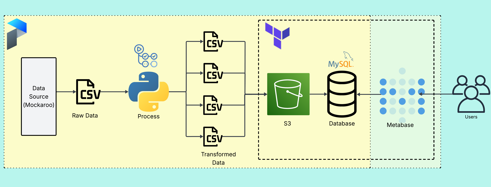
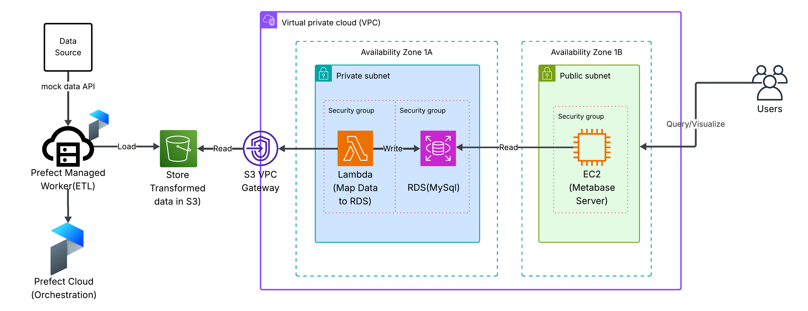
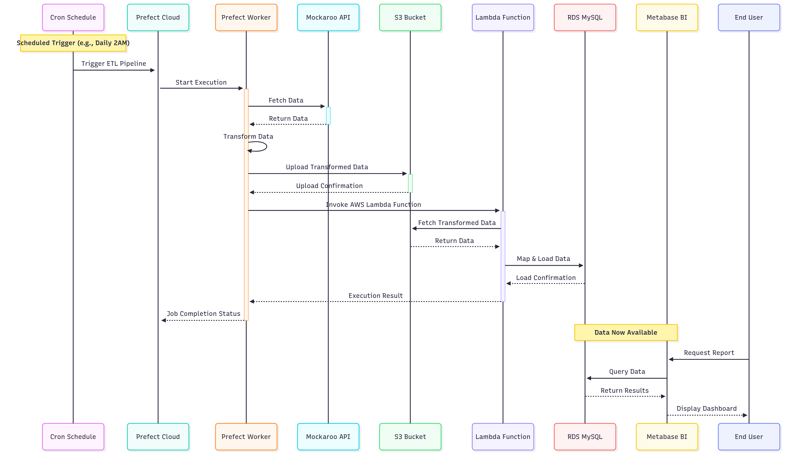
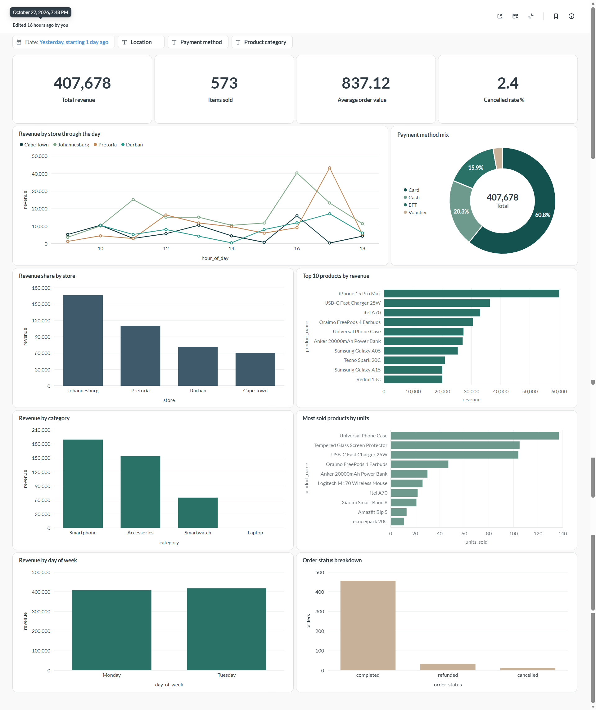
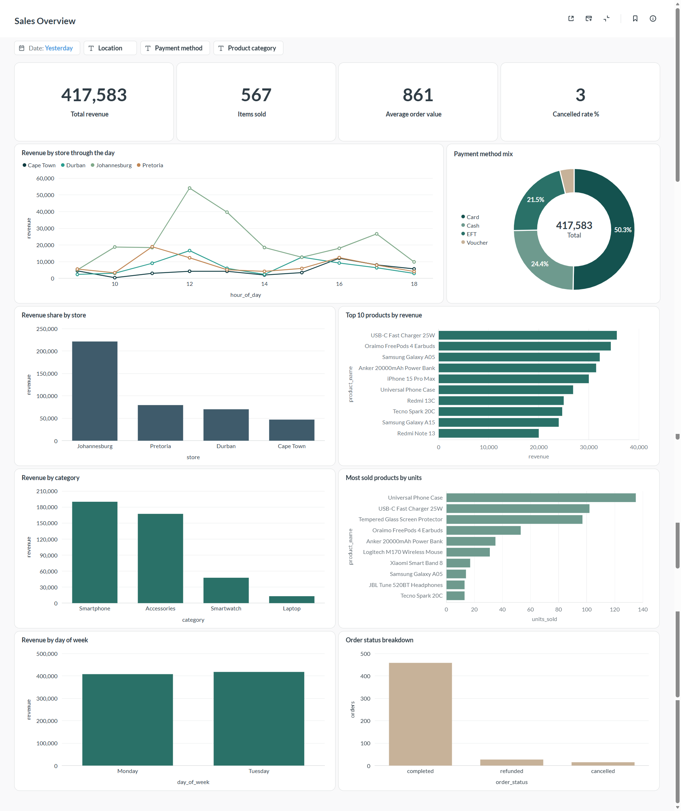

# __Automated-Sales-Pipeline-Dashboard__

## 📘 Table of Contents

- [Project Overview](#project-overview)  
- [Tech Stack](#tech-stack)  
- [Architecture](#architecture)  
- [How it works](#how-it-works)  
- [Database schema](#database-schema)  
- [Dashboard](#dashboard)  
- [Monitoring](#monitoring)  
- [CI/CD](#cicd)  
- [Environment setup](#environment-setup)  
  - [Mockaroo](#1mockaroo)  
  - [Virtual environment](#2virtual-environmenet)  
  - [Cloud setup](#3-cloud-setup)  
    - [Terraform Installation](#31-terraform-installation)  
    - [Project Setup and Configuration](#32-project-setup-and-configuration)  
    - [Spin up AWS Services](#33-spin-up-aws-services)  
    - [Accessing Metabase and Initializing RDS](#34-accessing-metabase-and-initializing-rds)  
    - [S3 Bucket Information](#35-s3-bucket-information)  
  - [Prefect Setup](#4-prefect-setup)  
    - [Create API Key](#41-create-api-key)  
    - [Configure Prefect Blocks for Credentials](#42-configure-prefect-blocks-for-credentials)  
    - [Configure Prefect worker pool](#43-configure-prefect-worker-pool)  
    - [Configure GitHub secrets](#43-configure-github-secrets)  
  - [Scripts and yaml files](#5-scripts-and-yaml-files)  
    - [Yaml](#51-yaml)  
    - [Scripts](#52-scripts)  
  - [Deploying](#6-deploying)  
  - [EC2 server application](#7-ec2-server-application)  
- [License](#license)


## __Project Overview__
This project implements an automated data pipeline that runs on a weekly schedule to extract, transform, and load (ETL) sales data. The pipeline is orchestrated using Prefect, with data flowing from a synthetic data source (Mockaroo) through S3, and finally into an RDS MySQL database. After the data is loaded, a Metabase dashboard automatically refreshes to provide up-to-date weekly sales insights for end users.

The goal of this pipeline is to demonstrate an end-to-end solution for automated data ingestion, transformation, and business intelligence reporting all fully deployed on AWS and Prefect Cloud, using scalable, modular components.



## __Tech Stack__

- **Prefect Cloud** – Workflow orchestration
- **AWS S3** – Storage for raw and transformed data
- **AWS Lambda** – Serverless compute to load data into RDS
- **Amazon RDS (MySQL)** – Relational database for structured storage
- **Metabase** – Business Intelligence and dashboarding
- **Mockaroo** – Synthetic data source
- **Terraform** – Infrastructure as Code 

---

## Architecture



This diagram shows the flow of data from → Mockaroo → S3 → Lambda → RDS → Metabase, At the heart of this system is Prefect, a modern workflow orchestration framework that automates and schedules the entire ETL process. Using Prefect Cloud, the pipeline runs seamlessly on a weekly basis without manual intervention enabling scalable, reliable, and observable data workflows across cloud services

---

## __How it works__


The data flows through the pipeline in a series of automated steps:

__1.Scheduled Trigger:__

- The entire ETL pipeline is initiated by a scheduled trigger (e.g., a weekly cron job at 2 AM) configured within Prefect Cloud.

__2.ETL Pipeline Start (Prefect):__ 
- Prefect Cloud signals a Prefect Worker to start the ETL execution. A prefect worker is a background process that runs and executes your Prefect flows and tasks.

__3.Data Extraction (Python via Prefect):__ 
- The Prefect Worker executes the Python ETL script. This script connects to the Mockaroo API to fetch the "Raw Data" (CSV).

__4.Data Transformation (Python via Prefect):__ 
- The Python script then performs all necessary data cleaning and transformation operations on the raw data. This results in "Transformed Data," typically split into multiple CSV files for organizational purposes.
The Python script then performs all necessary data cleaning and transformation operations on the raw data. This process includes data modeling, restructuring the raw data and outputting it into multiple CSV files. Each of these CSVs is designed to represent a specific, structured dataset, typically corresponding to a distinct table in the target relational database.

__5.Data Staging (Python to S3):__ 
- The Python script loads the "Transformed Data" (multiple CSVs) into the designated S3 Bucket.

__6.Load Orchestration (Prefect to Lambda):__ 
- Once the data is uploaded to S3, Prefect invokes an AWS Lambda Function. This Lambda function is specifically designed to handle the loading of data from S3 into the database.

__7.Data Loading (Lambda to RDS MySQL):__ 
- The Lambda Function fetches the transformed CSV files from the S3 Bucket and upserts them into the appropriate tables within the RDS MySQL Database. No id mapping is needed: the files already carry the SKUs, store codes and transaction UUIDs that the tables use as keys.

__8.Job Completion & Data Availability:__ 
- Upon successful loading, the Lambda function signals back to Prefect, indicating the completion of the loading phase. At this point, the data is "Data Now Available" in the database.

__9.Business Intelligence (Metabase):__ 
- Metabase BI continuously queries the RDS MySQL Database.

__10.User Consumption:__ 
- End Users interact with Metabase to request reports or view dashboards, allowing them to query the newly available data and gain insights.

---

## __Resource naming__

Everything this project creates in AWS carries a `Name` tag of the form `sales-pipeline-<role>`, plus `Project = sales-pipeline` and `ManagedBy = terraform` from the provider's `default_tags`. Consequently:

| Tag / name | Resource |
|---|---|
| `sales-pipeline-vpc` | VPC `10.0.0.0/16` |
| `sales-pipeline-public-1/2` | Public subnets (`10.0.101.0/24`, `10.0.103.0/24`) |
| `sales-pipeline-private-1/2` | Private subnets (`10.0.102.0/24`, `10.0.104.0/24`) |
| `sales-pipeline-public-rt` / `-private-rt` | Route tables (IGW / S3 endpoint) |
| `sales-pipeline-igw` | Internet gateway |
| `sales-pipeline-s3-endpoint` | S3 gateway VPC endpoint |
| `sales-pipeline-data-bucket` | S3 bucket (`etl-data-sales-pipeline`) |
| `sales-pipeline-db` | RDS instance (`electronics-shop-db`) |
| `sales-pipeline-db-subnets` | DB subnet group |
| `sales-pipeline-lambda-sg` | Security group attached to the loader Lambda |
| `sales-pipeline-rds-sg` | Security group guarding port 3306 |
| `sales-pipeline-metabase-sg` | Security group for the Metabase host |
| `sales-pipeline-loader` | Lambda function |
| `sales-pipeline-lambda-role` | Lambda IAM role |
| `sales-pipeline-metabase` | EC2 instance running Metabase |
| `sales-pipeline-metabase-key` | EC2 key pair |
| `sales-pipeline-schema-initializer` | Lambda that creates the database schema |
| `sales-pipeline-schema-init-sg` | Security group for the schema-initializer Lambda |

The RDS instance **identifier** stays `electronics-shop-db` (renaming it changes the endpoint DNS and would break Metabase's saved connection), but its `Name` tag is `sales-pipeline-db`.

## __Database schema__

The database is a small star schema: three dimension tables and one fact table, created once by the `sales-pipeline-schema-initializer` Lambda (see [Initializing RDS](#34-accessing-metabase-and-initializing-rds)).

| Table | Key | Other columns |
|---|---|---|
| `products` | `product_id` — the SKU, e.g. `SKU-1014` | `product_name`, `product_category` |
| `stores` | `store_id`, e.g. `STR-DBN-01` | `store_location`, `store_region` |
| `customers` | `customer_id` — `AUTO_INCREMENT`, assigned by MySQL | `customer_name` (`UNIQUE`) |
| `sales` | `transaction_id` — UUID | `transaction_date`, `transaction_time`, `day_of_week`, `product_id`, `customer_id`, `store_id`, `price`, `quantity_sold`, `total_sale`, `currency_code`, `payment_method`, `order_status` |

`sales` holds one row per product line of a transaction, and points at the three dimensions with foreign keys.

**How the sale date is set**

The Mockaroo schema returns the trading day itself — yesterday's date — so `transaction_date` and `day_of_week` arrive already correct and are passed through untouched. The pipeline adds no date logic of its own; the source is the single place that decides which day a batch covers.

**Why the keys look like this**

- `product_id` and `store_id` arrive from the source as stable business keys, so they are used directly — no surrogate ids are invented in Python.
- `customer_name` is all the source gives us for a customer, so MySQL assigns `customer_id` with `AUTO_INCREMENT`. The loader inserts names with `INSERT IGNORE` and then reads the ids back, which keeps every existing row pointing at the same person.
- The 36 highest-sorted customer names are replaced on every run with generated names from a 100-name pool, so the dataset does not show the same customer list forever. Each original name maps to exactly one new one, so a customer's order history stays together. The first 4 names in sorted order are left untouched, which keeps a handful of recognisable customers across runs.
- `transaction_id` is a UUID, unique per transaction, which makes the table safe to append to across runs.

**Loading is incremental**

The loader never deletes. Every table is written with `INSERT ... ON DUPLICATE KEY UPDATE`, so re-running a flow is idempotent, retries are safe, and earlier days stay in `sales` — which is what the daily filter in Metabase needs.

---

## __Dashboard__

<table>
  <tr>
    <td style="text-align: center;">
      <br/>
      <b>Figure 1:</b> Week 1
    </td>
    <td style="text-align: center;">
      <br/>
      <b>Figure 2:</b> Week 2
    </td>
  </tr>
</table>

The images above display the dashboard for two different weeks. The second image reflects the updated dashboard with refreshed data.


To view the dashboard for demo purposes, please contact me at [lamel446@gmail.com](mailto:lamel446@gmail.com) so i can create a user for.
You will then receive access to the dashboard hosted via **[Metabase](https://insightportals.fyi)**, where you can explore the dashboard or run queries.

> ⚠️ **Note**: Public access is disabled because the application is hosted on a free-tier service. Free-tier servers often have limited memory and CPU, which means multiple users accessing the dashboard at the same time could overload the server and cause it to crash. Controlled access helps prevent this and ensures a smoother experience for each user.

---
## __Project Documentation__
For detailed documentation of the project, please refer to [📄project documentation](docs/)

## __Monitoring__
Since the front end runs on AWS services, an AWS CloudWatch dashboard is used to monitor the health and performance of key infrastructure components including EC2, RDS, and S3. The dashboard tracks metrics such as available storage in RDS and S3 buckets, EC2 read/write bytes, and CPU utilization, providing real-time visibility into system resource usage, A comprehensive overview of these metrics is available in the documentation, which includes detailed views of EC2, RDS, and S3 performance indicators.

Since the prefect worker is running on Prefect's hosted infrastructure ("Prefect hardware"), direct monitoring of the underlying machine is not possible. However, the Prefect UI clearly indicates the worker status, if it shows as "Ready", it means the worker is actively polling and available to execute flows. If the status is not ready, scheduled flows will not run.

The prefect worker provides detailed logs for each step of the ETL process, making it easy to trace the execution path. Additionally, notifications (such as email alerts) are sent automatically on flow success or failure, ensuring visibility into pipeline outcomes.

---

## CI/CD
Changes made to the scripts are deployed only if the CI/CD pipeline passes successfully.  
This ensures that no broken code with errors is pushed to production.  
The CI/CD pipeline runs configuration checks, test scripts, and other validations.  
Only after passing all these checks is the flow deployed.

---

## __Environment setup__

> **Note:** The AWS services used in this project are mostly within the Free Tier. However, **insignificant charges may still occur** depending on usage.  
> It is recommended to use this repository only if you have some experience with **AWS** and **Terraform**.  
> If you'd prefer to integrate with your own set of cloud services or alternatives, you are free to modify and replace the existing configuration to suit your setup.


### 1.Mockaroo
First, head to [Mockaroo](https://www.mockaroo.com) and sign up for an account.  
After signing up, open a new tab and paste this link: [Mockaroo Dataset](https://www.mockaroo.com/72087140) to clone the schema. The pipeline reads the schema id from `MOCKAROO_SCHEMA_ID` in `etl_pipeline/extract.py`.  

Once cloned, navigate to the profile icon to find your API key. Make sure to store it securely.

### 2.Virtual environmenet
```
git clone https://github.com/LamelK/automated-sales-pipeline-dashboard.git
```

- It is recommended to use a Linux terminal (e.g., WSL). 
- create a Python 3.13 environment using either venv or conda(need to install first). After creating the environment, activate it and install the required packages. The Lambdas run on `python3.13`.

Change the directory to the root folder of the repository.
```
pip install -r requirements.txt
```

### 3. Cloud setup
#### 3.1. Terraform Installation
-   Terraform is not included in `requirements.txt` as it is a separate CLI tool, written in Go, not a Python package.
-   Refer to the [Terraform Installation Guide (Official)](https://developer.hashicorp.com/terraform/tutorials/aws-get-started/install-cli) for guidance on how to install Terraform.

#### 3.2. Project Setup and Configuration
- Once installed, in your terminal, change directory to your Terraform folder.
- Input this command to generate the SSH key for your EC2 instance, secure this key as it will be used to ssh in your instance:
    ```bash
    ssh-keygen -t rsa -b 4096 -f ./metabase
    ```
- After generating the keys, you can open `variables.tf` or `main.tf` to customize values such as the S3 bucket name, RDS database name, username, region, etc., according to your preferences.
- The EC2 instance type is set by `ec2_instance_type` in `variables.tf`, and defaults to `t3.small` (2 vCPU, 2 GiB RAM). Earlier versions used `t3.micro`, whose 1 GiB of RAM caused Metabase to slow down or crash under load. The `user_data` script still adds a 2 GiB swap file as a safety margin.

        -   ⚠️ **Note:** Any instance besides `t2.micro` and `t3.micro` are not included in the AWS Free Tier, so `t3.small` incurs charges.

#### 3.3. Spin up AWS Services
-  Ensure that you have your AWS credentials configured in your system.
-  in the same folder as the terraform files,type `terraform plan` in the terminal. This will show your spin-up plan and any other errors that might have been improperly configured.
- The files in `terraform/` ending in `.zip` are the Lambda packages Terraform uploads (`lambda_deployment_package1.zip` → loader, `lambda_schema_initializer1.zip` → schema initializer). Each must contain its handler, the `pymysql` dependency and the RDS CA bundle `global-bundle.pem`. Rebuild them after any handler change, otherwise `terraform apply` deploys the old code:

    ```bash
    python lambda/build_packages.py
    ```
-  After reviewing the plan, type `terraform apply`. This process will take a while as it spins up AWS services.
-  If not successful, see which services failed and fix them.
-  If successful, it will show you the output with some of your credentials. Store them safely. The DB password will not be displayed. To get it, input:
    ```bash
    terraform output db_password
    ```
    Save this password safely.

#### 3.4 Accessing Metabase and Initializing RDS
##### Metabase
  - Navigate to the AWS Console -> EC2 -> select your server and copy the public IP.
  - Paste this into a new browser tab: `https://<public-ip>:3000`. This should open the Metabase application.
  - If the page can't be reached, it means Metabase didn't install successfully during spin-up. You will have to SSH into the instance, using the key you generated previously

      ```bash
      ssh -i "automated-sales-pipeline-dashboard/terraform/metabase" ubuntu@<public-ip>
      ```
      Once connected, install Java 21 first, then Metabase, and finally start the Metabase service manually.
##### Initializing RDS
  - Create the schema once by invoking the `sales-pipeline-schema-initializer` Lambda (the DDL lives in `lambda/lambda_schema_initializer.py` and is idempotent):

      ```bash
      aws lambda invoke --function-name sales-pipeline-schema-initializer --payload '{}' out.json && cat out.json
      ```

      It must run before the first flow, and the four tables it creates are described in [Database schema](#database-schema).
  - RDS runs **MySQL 8.4** on `db.t3.micro` inside the private subnets (`publicly_accessible = false`). Only the loader Lambda, the schema-initializer Lambda and Metabase may connect — by security group, not by IP. MySQL 8.4 removed `mysql_native_password`, so both Lambdas connect over TLS using the bundled `global-bundle.pem` CA.
  - To use a client from your machine, tunnel through the Metabase instance:

      ```bash
      ssh -i ./metabase -N -L 3306:electronics-shop-db.c3gmowagaqoc.eu-north-1.rds.amazonaws.com:3306 ubuntu@<metabase-public-ip>
      ```

      Then connect the client to `127.0.0.1:3306` with the database name, username and password from the Terraform output.
  - Metabase will also prompt you to enter the **database name**, **username**, **password**, and **host**.  
  Use the values you received from the Terraform output, this step links Metabase to the RDS instance.


#### 3.5. S3 Bucket Information
- Go to S3 in the AWS Console and make note of the S3 bucket name. This bucket will be used by your data pipeline.

### 4. Prefect Setup 
##### 4.1 Create API Key
- Go to the Prefect UI at [Prefect Cloud](https://app.prefect.cloud).
- Click your **profile icon** (usually top-left) and select **"API Key"**.
- Create API Key
- After creation, you will receive the API key (Access Token) and login url. **Store this securely immediately**, as it is shown only once and cannot be retrieved later.

##### 4.2. Configure Prefect Blocks for Credentials
- In the Prefect UI, navigate to **Settings**.
- Select **Blocks** and Click **Create Block**.
- Choose the **Secrets** block type.
- Create a block named `credentials`.
- In the block's configuration, input your sensitive information in JSON format. Replace the asterisks with your actual values:
    ```json
    {
      "S3_BUCKET_NAME": "your_s3_bucket_name",
      "PREFECT_API_KEY": "your_prefect_api_key",
      "MOCKAROO_API_KEY": "your_mockaroo_api_key",
      "AWS_ACCESS_KEY_ID": "your_aws_access_key_id",
      "AWS_SECRET_ACCESS_KEY": "your_aws_secret_access_key"
    }
    ```
    * You will input all your details you just created 
- Create another block but this time choose the **AWS Credentials Block**
- Go back to the **Blocks** page.
- Input your AWS `ACCESS_KEY_ID` and `SECRET_ACCESS_KEY` into the respective fields provided within this block.

##### 4.3. Configure Prefect worker pool
- Navigate to **Worker Pools** from the left-hand menu and create a new worker pool.  
  The Hobby tier only supports the **Managed** worker pool type, so select that option.  
  Name the worker pool **etl-workpool**, leave the other fields as default, and click **Create**.

##### 4.3. Configure GitHub secrets
- On your forked repo, navigate to **Settings** → **Secrets and variables** → **Actions**.
- Click **New repository secret** and add the following:
  - `PREFECT_API_KEY`
  - `AWS_ACCESS_KEY_ID`
  - `AWS_SECRET_ACCESS_KEY`

### 5. Scripts and yaml files
#### 5.1 Yaml
- In the workflow YAML file **prefect-ci-cd.yaml**, update the Prefect login command to match your account.  
  You can find your workspace name in the Prefect Cloud UI under **Settings → Workspaces**.  
  Also, ensure your GitHub secrets are configured as described above.

- In the **prefect.yaml** file, update the following:
  - Replace the placeholder S3 bucket name with **your actual S3 bucket name**.
  - Replace the `AWS_ROLE_ARN` value with the **IAM role ARN assigned to your Lambda function**.

  These changes are required to allow the flow to access your S3 bucket and invoke the Lambda function securely.


#### 5.2 Scripts
- The Lambda function is named `sales-pipeline-loader` in both `etl_flow.py` and `terraform/main.tf`, so no edit is needed. If you rename it in AWS, update the `lambda_function_name` variable in `etl_flow.py` and the matching assertion in `test_etl_flow.py`:
  ```python
  lambda_function_name = "sales-pipeline-loader"
  ```
- The region used to invoke the Lambda comes from the Prefect secret block, not from the code. Add an `AWS_REGION` key to the `credentials` block, or leave it out to default to `us-west-1` (the default in `terraform/variables.tf`).
  Keeping it aligned with `var.aws_region` is what makes the invocation resolve the function.

To test the flow locally, run the `run_pipeline.py` script.  
Then, go to the Prefect UI to observe the flow execution.  
If there are any errors, check the logs in the UI and address them accordingly.

### 6. Deploying
- Add your changes, commit them, and push to GitHub — this should trigger the CI/CD workflow.
- The CI/CD will pass when:
  - All test scripts succeed.
  - All required credentials and configurations are correctly set
- Once the workflow runs successfully, go to the Prefect UI → **Deployments**, and you should see `etl-deployment` with a status of **Ready**.
  You can now execute this deployment by select options `quick-run`, which will run the entire pipeline. You can monitor the flow execution and logs directly from the UI.
- Note: GitHub may queue the workflow if the repository is forked, as forked repos are given lower priority.
  If you want faster execution, you can install a self-hosted runner on your machine.  
  If you do that, you may also need to run:
  ```
  git config --global --add safe.directory "/home/your-username/actions-runner/_work/automated-sales-pipeline-dashboard/automated-sales-pipeline-dashboard"
  ```
  This is because Git may block commands in the runner if the folder belongs to a different user.
  That command tells Git to trust the folder so the workflow can run without issues.

### 7. EC2 server application
- Once the workflow runs successfully, you should have data loaded into the RDS database and linked to Metabase.  
  You can create a few charts in Metabase and save them.  
  After that, re-run the `etl-deployment` workflow from the Prefect UI.  
  When the flow completes, go back to Metabase — you’ll notice that the charts reflect the updated data.
- You can also set a **cron schedule** for your `etl-deployment` directly from the Prefect UI to automate the pipeline.

---


## License

This project is licensed under the MIT License


