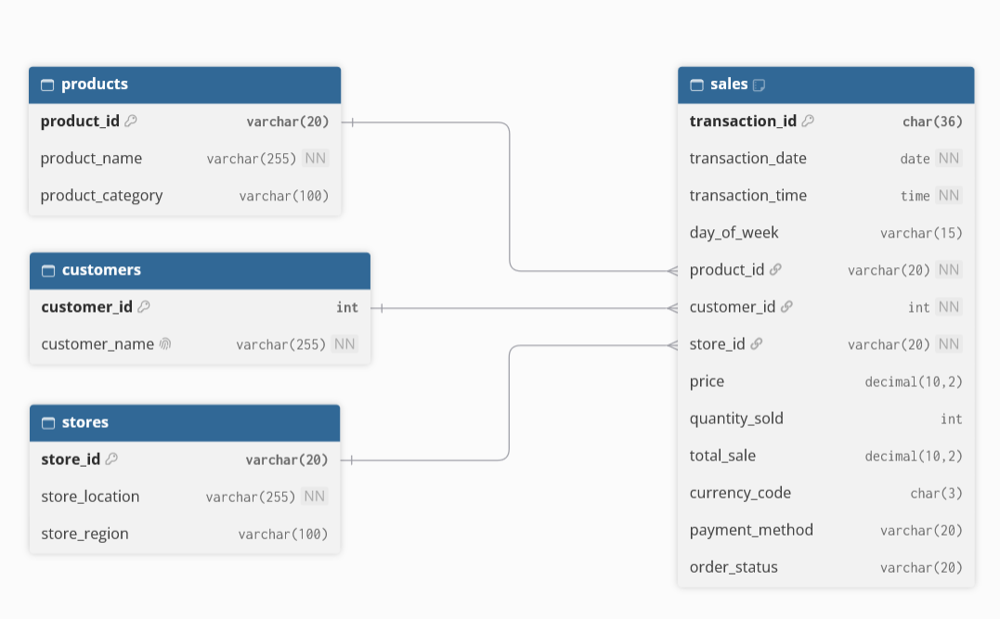

# Automated Sales Pipeline Dashboard

## 📘 Table of Contents

- [Project Overview](#project-overview)  
- [Tech Stack](#tech-stack)  
- [Architecture](#architecture)  
- [How it works](#how-it-works)  
- [Resource naming](#resource-naming)  
- [Database schema](#database-schema)  
- [Dashboard](#dashboard)  
- [Project Documentation](#project-documentation)  
- [Monitoring](#monitoring)  
- [CI/CD](#cicd)  
- [Environment setup](#environment-setup)  
  - [Mockaroo](#1mockaroo)  
  - [Virtual environment](#2virtual-environment)  
  - [Cloud setup](#3-cloud-setup)  
    - [Terraform Installation](#31-terraform-installation)  
    - [Project Setup and Configuration](#32-project-setup-and-configuration)  
    - [Spin up AWS Services](#33-spin-up-aws-services)  
    - [Accessing Metabase and Initialising RDS](#34-accessing-metabase-and-initialising-rds)  
    - [S3 Bucket Information](#35-s3-bucket-information)  
  - [Prefect Setup](#4-prefect-setup)  
    - [Create API Key](#41-create-api-key)  
    - [Configure Prefect Blocks for Credentials](#42-configure-prefect-blocks-for-credentials)  
    - [Configure Prefect worker pool](#43-configure-prefect-worker-pool)  
    - [Configure GitHub secrets](#44-configure-github-secrets)  
  - [Scripts and yaml files](#5-scripts-and-yaml-files)  
    - [Yaml](#51-yaml)  
    - [Scripts](#52-scripts)  
  - [Deploying](#6-deploying)  
  - [EC2 server application](#7-ec2-server-application)  
- [License](#license)


## Project Overview
This project implements an automated data pipeline that runs on a daily schedule to extract, transform, and load (ETL) sales data. The pipeline is orchestrated using Prefect, with data flowing from a synthetic data source (Mockaroo) through S3, and finally into an RDS MySQL database. After the data is loaded, a Metabase dashboard automatically refreshes to provide up-to-date sales insights for end users.

The schedule is `0 2 * * *` in the `Africa/Johannesburg` time zone, defined on the `etl-deployment` in [prefect.yaml](prefect.yaml).

The goal of this pipeline is to demonstrate an end-to-end solution for automated data ingestion, transformation, and business intelligence reporting all fully deployed on AWS and Prefect Cloud, using scalable, modular components.


## Tech Stack

- **Prefect Cloud**: workflow orchestration
- **AWS S3**: storage for raw and transformed data
- **AWS Lambda**: serverless compute to load data into RDS
- **Amazon RDS (MySQL)**: relational database for structured storage
- **Metabase**: business intelligence and dashboarding
- **Mockaroo**: synthetic data source
- **Terraform**: infrastructure as code

---

## Architecture


This diagram shows the flow of data: Mockaroo → S3 → Lambda → RDS → Metabase. At the heart of the system is Prefect, which automates and schedules the whole ETL process. With Prefect Cloud the pipeline runs every day without any manual work, and you can follow each step in the UI.

---

## How it works


The data flows through the pipeline in a series of automated steps:

__1.Scheduled Trigger:__

- The entire ETL pipeline is started by the schedule on the `etl-deployment` in Prefect Cloud. Right now that is `0 2 * * *`, which means every day at 02:00 in the `Africa/Johannesburg` time zone.

__2.ETL Pipeline Start (Prefect):__ 
- Prefect Cloud signals a Prefect Worker to start the ETL execution. A prefect worker is a background process that runs and executes your Prefect flows and tasks.

__3.Data Extraction (Python via Prefect):__ 
- The Prefect Worker executes the Python ETL script. This script connects to the Mockaroo API to fetch the "Raw Data" (CSV).

__4.Data Transformation (Python via Prefect):__ 
- The Python script performs all necessary data cleaning and transformation operations on the raw data. This includes data modeling, restructuring the raw data and outputting it into multiple CSV files. Each of these CSVs is designed to represent a specific, structured dataset, typically corresponding to a distinct table in the target relational database.

__5.Data Staging (Python to S3):__ 
- The Python script loads the "Transformed Data" (multiple CSVs) into the designated S3 Bucket. Every run writes to its own prefix (`transformed_data/<run-timestamp>/...`, plus the untouched extract under `raw_data/<run-timestamp>/`), so runs never overwrite each other.

__6.Load Orchestration (Prefect to Lambda):__ 
- Once the data is uploaded to S3, Prefect invokes an AWS Lambda Function. This Lambda function is specifically designed to handle the loading of data from S3 into the database.

__7.Data Loading (Lambda to RDS MySQL):__ 
- The Lambda Function fetches the transformed CSV files from the S3 Bucket and upserts them into the appropriate tables within the RDS MySQL Database. No id mapping is needed: the files already carry the SKUs, store codes and transaction UUIDs that the tables use as keys.

__8.Job Completion & Data Availability:__ 
- Upon successful loading, the Lambda function signals back to Prefect, indicating the completion of the loading phase. At this point, the data is "Data Now Available" in the database.

__9.Business Intelligence (Metabase):__ 
- Metabase BI continuously queries the RDS MySQL Database.

__10.User Consumption:__ 
- End Users interact with Metabase to request reports or view dashboards, allowing them to query the newly available data and gain insights.

---

## Resource naming

Everything this project creates in AWS carries a `Name` tag of the form `sales-pipeline-<role>`, plus `Project = sales-pipeline` and `ManagedBy = terraform` from the provider's `default_tags`. Consequently:

| Tag / name | Resource |
|---|---|
| `sales-pipeline-vpc` | VPC `10.0.0.0/16` |
| `sales-pipeline-public-1/2` | Public subnets (`10.0.101.0/24`, `10.0.103.0/24`) |
| `sales-pipeline-private-1/2` | Private subnets (`10.0.102.0/24`, `10.0.104.0/24`) |
| `sales-pipeline-public-rt` / `-private-rt` | Route tables (IGW / S3 endpoint) |
| `sales-pipeline-igw` | Internet gateway |
| `sales-pipeline-s3-endpoint` | S3 gateway VPC endpoint |
| `sales-pipeline-data-bucket` | S3 bucket (`etl-data-sales-pipeline`) |
| `sales-pipeline-db` | RDS instance (`electronics-shop-db`) |
| `sales-pipeline-db-subnets` | DB subnet group |
| `sales-pipeline-lambda-sg` | Security group attached to the loader Lambda |
| `sales-pipeline-rds-sg` | Security group guarding port 3306 |
| `sales-pipeline-metabase-sg` | Security group for the Metabase host |
| `sales-pipeline-loader` | Lambda function |
| `sales-pipeline-lambda-role` | Lambda IAM role |
| `sales-pipeline-metabase` | EC2 instance running Metabase |
| `sales-pipeline-metabase-key` | EC2 key pair |
| `sales-pipeline-schema-initializer` | Lambda that creates the database schema |
| `sales-pipeline-schema-init-sg` | Security group for the schema-initializer Lambda |

The RDS instance **identifier** stays `electronics-shop-db` (renaming it changes the endpoint DNS and would break Metabase's saved connection), but its `Name` tag is `sales-pipeline-db`.

## Database schema

The database is a small star schema: three dimension tables and one fact table, created once by the `sales-pipeline-schema-initializer` Lambda (see [Initialising RDS](#34-accessing-metabase-and-initialising-rds)).



The diagram shows the four tables and the three foreign keys that `sales` holds into `products`, `customers` and `stores`.

| Table | Key | Other columns |
|---|---|---|
| `products` | `product_id` (the SKU, e.g. `SKU-1014`) | `product_name`, `product_category` |
| `stores` | `store_id`, e.g. `STR-DBN-01` | `store_location`, `store_region` |
| `customers` | `customer_id` (`AUTO_INCREMENT`, assigned by MySQL) | `customer_name` (`UNIQUE`) |
| `sales` | `transaction_id` (UUID) | `transaction_date`, `transaction_time`, `day_of_week`, `product_id`, `customer_id`, `store_id`, `price`, `quantity_sold`, `total_sale`, `currency_code`, `payment_method`, `order_status` |

`sales` holds one row per transaction, keyed on `transaction_id`, and points at the three dimensions with foreign keys. If a transaction ever needed to be stored as separate product lines, the primary key would have to become a composite of `transaction_id` and `product_id`.

**How the sale date is set**

The Mockaroo schema returns the trading day itself, which is yesterday's date, so `transaction_date` and `day_of_week` arrive already correct and are passed through untouched. The pipeline adds no date logic of its own; the source is the single place that decides which day a batch covers.

**Why the keys look like this**

- `product_id` and `store_id` arrive from the source as stable business keys, so they are used directly and no surrogate ids are invented in Python.
- `customer_name` is all the source gives us for a customer, so MySQL assigns `customer_id` with `AUTO_INCREMENT`. The loader inserts names with `INSERT IGNORE` and then reads the ids back, which keeps every existing row pointing at the same person.
- `transaction_id` is a UUID, unique per transaction, which makes the table safe to append to across runs.

**Loading is incremental**

The loader never deletes. Every table is written with `INSERT ... ON DUPLICATE KEY UPDATE`, so re-running a flow is idempotent, retries are safe, and earlier days stay in `sales`. That is what the daily filter in Metabase needs.

---

## Dashboard

<table>
  <tr>
    <td style="text-align: center;">
      <br/>
      <b>Figure 1:</b> Day 1
    </td>
    <td style="text-align: center;">
      <br/>
      <b>Figure 2:</b> Day 2
    </td>
  </tr>
</table>

The images above show the dashboard side by side for two different days. The second image reflects the dashboard with refreshed data.


To view the dashboard for demo purposes, please contact me at [lamel446@gmail.com](mailto:lamel446@gmail.com) so i can create a user for.
You will then receive access to the dashboard hosted via **[Metabase](https://lamelsmetabase.fyi)**, where you can explore the dashboard or run queries.

> ⚠️ **Note**: Public access is disabled because the application is hosted on a free-tier service. Free-tier servers often have limited memory and CPU, which means multiple users accessing the dashboard at the same time could overload the server and cause it to crash. Controlled access helps prevent this and ensures a smoother experience for each user.

---
## Project Documentation

> **Note:** The PDF in [docs/](docs/) ([project documentation](docs/Project_Documentation.pdf)) describes the **first version** of this project, which ran the ETL as a **weekly** batch. The pipeline has since been updated to run **daily** batches instead, using the cron schedule in [prefect.yaml](prefect.yaml). So read the PDF as background on how the project was originally built, and not as a description of how it runs today. If the two ever disagree, this README is the one to trust.

If you are interested in how that old weekly version runs, check out the [`dev` branch](https://github.com/LamelK/automated-sales-pipeline-dashboard/tree/dev), which still has it:

```bash
git fetch origin
git switch dev
```

## Monitoring
Since the front end runs on AWS services, an AWS CloudWatch dashboard is used to monitor the health and performance of the main infrastructure: EC2, RDS and S3. It tracks things like available storage on RDS and in the S3 buckets, EC2 read/write bytes and CPU usage, so you get real-time visibility of how the system is using its resources. A more detailed overview of these metrics is in the documentation, which includes views of the EC2, RDS and S3 indicators.

The Prefect worker runs on Prefect's hosted infrastructure ("Prefect hardware"), so the machine behind it cannot be monitored directly. The Prefect UI does show the worker status, though: if it says "Ready", the worker is polling and available to run flows. If it is not ready, scheduled flows will not run.

The Prefect worker also keeps detailed logs for each step of the ETL process, which makes it easy to trace where a run went wrong. Notifications (such as email alerts) are sent automatically when a flow succeeds or fails, so you always know how a run ended.

---

## CI/CD
Changes made to the scripts are deployed only if the CI/CD pipeline passes successfully.  
The workflow lives in [.github/workflows/prefect-ci-cd.yml](.github/workflows/prefect-ci-cd.yml) and runs on every push and pull request to `main`.

- Tests: `pytest tests/` on Python 3.13, with `PYTHONPATH` set to the repository root.
- Deploy only happens on a push to `main`. Once the tests pass, the job logs in to Prefect Cloud with `PREFECT_API_KEY` and runs `prefect deploy --all`, which uploads the flow code to `s3://<bucket>/flows/`.

Pull requests from forks cannot read repository secrets, so the login step fails there. For those PRs the test result is what matters. GitHub secrets are set up in [Configure GitHub secrets](#44-configure-github-secrets).

---

## Environment setup

> **Note:** The AWS services used in this project are mostly within the Free Tier. However, **insignificant charges may still occur** depending on usage.  
> It is recommended to use this repository only if you have some experience with **AWS** and **Terraform**.  
> If you'd prefer to integrate with your own set of cloud services or alternatives, you are free to modify and replace the existing configuration to suit your setup.


### 1.Mockaroo
First, head to [Mockaroo](https://www.mockaroo.com) and sign up for an account.  
After signing up, open a new tab and paste this link: [Mockaroo Dataset](https://www.mockaroo.com/72087140) to clone the schema. The pipeline reads the schema id from `MOCKAROO_SCHEMA_ID` in `etl_pipeline/extract.py`.  

Once cloned, navigate to the profile icon to find your API key. Make sure to store it securely.

### 2.Virtual environment

```bash
git clone https://github.com/LamelK/automated-sales-pipeline-dashboard.git
cd automated-sales-pipeline-dashboard
```

- It is recommended to use a Linux shell (WSL on Windows) for this, since the Terraform and AWS CLI steps below assume bash.
- The Lambdas run on `python3.13`, so use Python 3.13 locally. CI uses the same version (see [.github/workflows/prefect-ci-cd.yml](.github/workflows/prefect-ci-cd.yml)), and `requirements.txt` pins the exact versions both use, so the tests run against the stack that ships.
- Create and activate a virtual environment, then install the dependencies:

```bash
python3.13 -m venv .venv
source .venv/bin/activate      # Windows PowerShell: .venv\Scripts\Activate.ps1
pip install -r requirements.txt
```

- Run the test suite to confirm the environment works:

```bash
python -m pytest -q
```

### 3. Cloud setup
#### 3.1. Terraform Installation
-   Terraform is not included in `requirements.txt` as it is a separate CLI tool, written in Go, not a Python package.
-   Refer to the [Terraform Installation Guide (Official)](https://developer.hashicorp.com/terraform/tutorials/aws-get-started/install-cli) for guidance on how to install Terraform.

#### 3.2. Project Setup and Configuration
- Once installed, in your terminal, change directory to your Terraform folder.
- Input this command to generate the SSH key for your EC2 instance, secure this key as it will be used to ssh in your instance:
    ```bash
    ssh-keygen -t rsa -b 4096 -f ./metabase
    ```
- After generating the keys, you can open `variables.tf` or `main.tf` to customise values such as the S3 bucket name, RDS database name, username, region, etc., according to your preferences. The defaults are `aws_region = "eu-north-1"`, `bucket_prefix = "etl-data-sales-pipeline"` (must be globally unique), `db_name = "electronics_shop"` and `db_username = "admin"`. If you change the region, set `AWS_REGION` in the Prefect `credentials` block to the same value (see [Prefect Setup](#4-prefect-setup)).
- The EC2 instance type is set by `ec2_instance_type` in `variables.tf`, and defaults to `t3.small` (2 vCPU, 2 GiB RAM). Earlier versions used `t3.micro`, whose 1 GiB of RAM caused Metabase to slow down or crash under load. The `user_data` script still adds a 2 GiB swap file as a safety margin.

- ⚠️ **Note:** Instance types other than `t2.micro` and `t3.micro` are not included in the AWS Free Tier, so `t3.small` incurs charges.

#### 3.3. Spin up AWS Services

> ⚠️ **Terraform state holds secrets.** `terraform/terraform.tfstate` and `terraform/terraform.tfstate.backup` store the generated RDS password, and the `metabase` / `metabase.pub` SSH keys sit next to them. All of these are already in `.gitignore`. Never commit them, and never paste their contents into an issue or a chat. Read the password back with `terraform output -raw db_password` instead of opening the state file.

-  Ensure that you have your AWS credentials configured in your system.
-  in the same folder as the terraform files,type `terraform plan` in the terminal. This will show your spin-up plan and any other errors that might have been improperly configured.
- The files in `terraform/` ending in `.zip` are the Lambda packages Terraform uploads (`lambda_deployment_package1.zip` → loader, `lambda_schema_initializer1.zip` → schema initializer). Each must contain its handler, the `pymysql` dependency and the RDS CA bundle `global-bundle.pem`. Rebuild them after any handler change, otherwise `terraform apply` deploys the old code:

    ```bash
    python lambda/build_packages.py
    ```
-  After reviewing the plan, type `terraform apply`. This process will take a while as it spins up AWS services.
-  If not successful, see which services failed and fix them.
-  If successful, it will show you the output with some of your credentials. Store them safely. The DB password will not be displayed. To get it, input:
    ```bash
    terraform output -raw db_password
    ```
    Save this password safely.

#### 3.4 Accessing Metabase and Initialising RDS
##### Metabase
  - The Metabase host has **no inbound rules**: port 3000 is deliberately closed and SSH is closed too. Traffic is expected to arrive through a Cloudflare tunnel (the demo instance is served at [lamelsmetabase.fyi](https://lamelsmetabase.fyi)); everything the instance does is outbound.
  - `terraform apply` already installs Java 21, downloads Metabase `v0.64.1`, adds a 2 GB swap file and runs Metabase under systemd (`metabase.service`), so a healthy host needs no manual setup.
  - To reach Metabase on a fresh deployment, either:
    - **Tunnel (how the demo runs):** install `cloudflared` on the instance and point a tunnel at `http://localhost:3000`.
    - **Temporary direct access:** add an inbound TCP 3000 rule (and TCP 22 if you need a shell) to the `sales-pipeline-metabase-sg` security group in the AWS console, then browse to `http://<metabase_public_ip>:3000`. Remove the rules afterwards.
  - `terraform output -raw metabase_public_ip` prints the Elastic IP. If Metabase is not serving, check `/var/log/metabase.log` and `systemctl status metabase` over SSH:

      ```bash
      terraform output -raw ssh_command
      # ssh -i ./metabase ubuntu@<metabase-public-ip>
      ```

      If the page still can't be reached, Metabase didn't install during spin-up; install Java 21 and Metabase on the instance and start the service manually.

##### Initialising RDS
  - Create the schema once by invoking the `sales-pipeline-schema-initializer` Lambda (the DDL lives in `lambda/lambda_schema_initializer.py` and is idempotent):

      ```bash
      aws lambda invoke --function-name sales-pipeline-schema-initializer --payload '{}' out.json && cat out.json
      ```

      It must run before the first flow, and the four tables it creates are described in [Database schema](#database-schema). Running it again is safe because the DDL is idempotent, so it is also fine if the schema was created by hand with the same statements.
  - RDS runs **MySQL 8.4** on `db.t3.micro` inside the private subnets (`publicly_accessible = false`). Only the loader Lambda, the schema-initializer Lambda and Metabase may connect, and access is controlled by security group rather than by IP address. MySQL 8.4 removed `mysql_native_password`, so both Lambdas connect over TLS using the bundled `global-bundle.pem` CA.
  - To use a client from your machine, tunnel through the Metabase instance (this needs TCP 22 open on `sales-pipeline-metabase-sg`):

      ```bash
      terraform output -raw rds_tunnel_command
      # ssh -i ./metabase -N -L 3306:<rds-endpoint>:3306 ubuntu@<metabase-public-ip>
      ```

      Then connect the client to `127.0.0.1:3306` with the database name, username and password from the Terraform output.
  - Metabase will also prompt you to enter the **database name**, **username**, **password**, and **host**.  
  Use the values you got from the Terraform output. This step links Metabase to the RDS instance.


#### 3.5. S3 Bucket Information
- Go to S3 in the AWS Console and make note of the S3 bucket name (`terraform output -raw s3_bucket_name`). This bucket will be used by your data pipeline.
- The bucket holds three kinds of prefixes:
  - `raw_data/<run-timestamp>/raw_sales_data.csv`: the untouched Mockaroo extract.
  - `transformed_data/<run-timestamp>/{customers,products,stores,sales}.csv`: the per-table files the Lambda loads.
  - `flows/`: the packaged flow code uploaded by `prefect deploy` and pulled by the worker at run time.

### 4. Prefect Setup 
##### 4.1 Create API Key
- Go to the Prefect UI at [Prefect Cloud](https://app.prefect.cloud).
- Click your **profile icon** (usually top-left) and select **"API Key"**.
- Create API Key
- After creation, you will receive the API key (Access Token) and login url. **Store this securely immediately**, as it is shown only once and cannot be retrieved later.

##### 4.2. Configure Prefect Blocks for Credentials
- In the Prefect UI, navigate to **Settings**.
- Select **Blocks** and Click **Create Block**.
- Choose the **Secrets** block type.
- Create a block named `credentials`.
- In the block's configuration, input your sensitive information in JSON format. Replace the asterisks with your actual values:
    ```json
    {
      "S3_BUCKET_NAME": "your_s3_bucket_name",
      "PREFECT_API_KEY": "your_prefect_api_key",
      "MOCKAROO_API_KEY": "your_mockaroo_api_key",
      "AWS_ACCESS_KEY_ID": "your_aws_access_key_id",
      "AWS_SECRET_ACCESS_KEY": "your_aws_secret_access_key"
    }
    ```
- `AWS_REGION` is optional: add it if your stack is not in `eu-north-1`, the region the flow falls back to (matching `var.aws_region` in `terraform/variables.tf`).
- Create another block, this time of type **AWS Credentials**. Name it **`aws-credentials`**. [prefect.yaml](prefect.yaml) references `prefect.blocks.aws-credentials.aws-credentials` for its S3 `push` / `pull` steps, so a different name breaks deployment packaging.
- Input your AWS `ACCESS_KEY_ID` and `SECRET_ACCESS_KEY` into the respective fields provided within this block.

##### 4.3. Configure Prefect worker pool
- Navigate to **Worker Pools** from the left-hand menu and create a new worker pool.  
  The Hobby tier only supports the **Managed** worker pool type, so select that option.  
  Name the worker pool **etl-workpool**, leave the other fields as default, and click **Create**.

##### 4.4. Configure GitHub secrets
- On your forked repo, navigate to **Settings** → **Secrets and variables** → **Actions**.
- Click **New repository secret** and add the following:
  - `PREFECT_API_KEY`
  - `AWS_ACCESS_KEY_ID`
  - `AWS_SECRET_ACCESS_KEY`

### 5. Scripts and yaml files
#### 5.1 Yaml
- In the workflow YAML file **prefect-ci-cd.yml** (under `.github/workflows/`), update the Prefect login command to match your account.  
  You can find your workspace name in the Prefect Cloud UI under **Settings → Workspaces**.  
  Also, ensure your GitHub secrets are configured as described above.

- In the **prefect.yaml** file, update the following:
  - Set the `bucket` in both the `push` (`push_to_s3`) and `pull` (`pull_from_s3`) steps to **your actual S3 bucket name**.
  - Check that `deployments[0].work_pool.name` matches the pool you created (`etl-workpool` by default).
  - Adjust `schedule.cron` (`0 2 * * *`) and `schedule.timezone` (`Africa/Johannesburg`) if you want a different cadence.

  There is no `AWS_ROLE_ARN` placeholder to fill in: deployment packaging authenticates through the `aws-credentials` block, and the flow itself authenticates with the keys in the `credentials` Secret block.


#### 5.2 Scripts
- The Lambda function is named `sales-pipeline-loader` in both `etl_flow.py` and `terraform/main.tf`, so no edit is needed. If you rename it in AWS, update the `lambda_function_name` variable in `etl_flow.py` and the matching assertion in `test_etl_flow.py`:
  ```python
  lambda_function_name = "sales-pipeline-loader"
  ```
- The region used to invoke the Lambda comes from the Prefect secret block, not from the code. Add an `AWS_REGION` key to the `credentials` block, or leave it out to default to `eu-north-1` (the default of `var.aws_region` in `terraform/variables.tf`).
  Keeping it aligned with `var.aws_region` is what makes the invocation resolve the function.

To test the flow locally, log in to Prefect Cloud first (the flow loads its credentials from your workspace) and then run the pipeline script:

```bash
prefect cloud login --key <your-prefect-api-key> --workspace "<workspace-handle>"
python etl_pipeline/run_pipeline.py
```

This is a real run. It calls Mockaroo, uploads to S3 and invokes the Lambda. Then, go to the Prefect UI to observe the flow execution.  
If there are any errors, check the logs in the UI and address them accordingly.

### 6. Deploying
- Add your changes, commit them, and push to GitHub. This should trigger the CI/CD workflow (`.github/workflows/prefect-ci-cd.yml`, note the `.yml` extension).
- The workflow runs on every push and pull request to `main`:
  - **Both** run `pytest tests/` on Python 3.13.
  - Only a **push** to `main` logs in to Prefect Cloud and runs `prefect deploy --all`.
  - Pull requests from forks cannot read repository secrets, so the Prefect login step fails there; use the test result as the signal for those PRs.
- To deploy without waiting for CI, log in and run the same command from the repository root:

  ```bash
  prefect cloud login --key <your-prefect-api-key> --workspace "<workspace-handle>"
  prefect deploy --all
  ```
- Once the workflow runs successfully, go to the Prefect UI → **Deployments**, and you should see `etl-deployment` with a status of **Ready**.
  You can now execute this deployment by select options `quick-run`, which will run the entire pipeline. You can monitor the flow execution and logs directly from the UI.
- Note: GitHub may queue the workflow if the repository is forked, as forked repos are given lower priority.
  If you want faster execution, you can install a self-hosted runner on your machine.  
  If you do that, you may also need to run:
  ```
  git config --global --add safe.directory "/home/your-username/actions-runner/_work/automated-sales-pipeline-dashboard/automated-sales-pipeline-dashboard"
  ```
  This is because Git may block commands in the runner if the folder belongs to a different user.
  That command tells Git to trust the folder so the workflow can run without issues.

### 7. EC2 server application
- Once the workflow runs successfully, you should have data loaded into the RDS database and linked to Metabase.  
  You can create a few charts in Metabase and save them.  
  After that, re-run the `etl-deployment` workflow from the Prefect UI.  
  When the flow completes, go back to Metabase and you will notice that the charts reflect the updated data.
- The deployment already ships with the daily cron schedule from `prefect.yaml`. To change it, edit the schedule there (and redeploy), or override it in the Prefect UI under **Deployments → `etl-deployment` → Schedule**.

---


## License

This project is licensed under the MIT License


